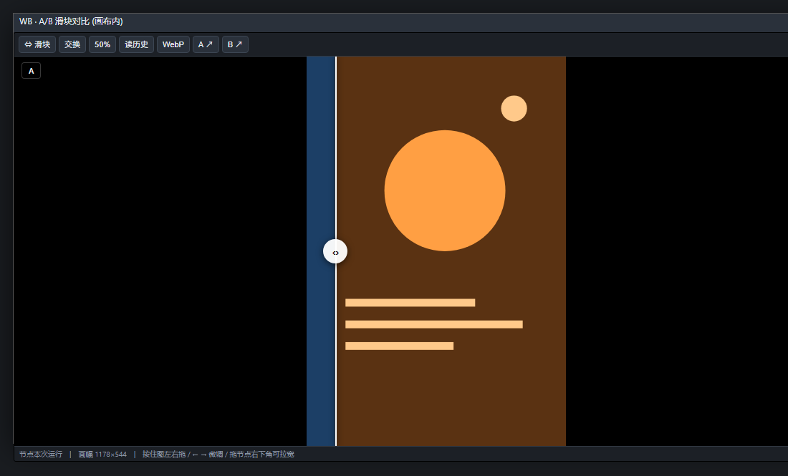

# WB A/B Slider · ComfyUI 画布内 A/B 滑块对比节点

一个**真正能在 ComfyUI 画布里拖动**的双图对比节点：左边 A、右边 B，按住鼠标左右拖分割线，节点可以随意拉宽拉高。图片由两路 `IMAGE` 输入在每次运行后直接推送，**不需要手动刷新、不需要读历史、不依赖任何第三方对比插件**。



> **English TL;DR** — A resizable, in-canvas A/B image slider for ComfyUI. Two `IMAGE` inputs, live results after each run, drag the divider with mouse/touch, swap/side-by-side/keyboard support. Install via ComfyUI Manager or `git clone` into `custom_nodes`, then **restart ComfyUI**.

---

## 目录

- [为什么做这个节点](#为什么做这个节点)
- [特性](#特性)
- [环境要求](#环境要求)
- [安装说明](#安装说明)
- [快速上手](#快速上手)
- [节点参数](#节点参数)
- [使用说明（完整）](#使用说明完整)
- [独立滑块页（备用）](#独立滑块页备用)
- [工作原理](#工作原理)
- [大图与性能](#大图与性能)
- [故障排查](#故障排查)
- [目录结构](#目录结构)
- [验证记录](#验证记录)
- [许可证](#许可证)

---

## 为什么做这个节点

常见的画布对比方案在新版 ComfyUI 上容易「只露一角 / 整块空白」，根因不在接线或图片，而在**前端布局机制**：

| 方案 | 现象 | 原因 |
|---|---|---|
| `Image Comparer (rgthree)` | 只显示顶部一条 / 完全空白 | 自定义 widget 的 `computeSize()` 把高度写死成 20px；并把浏览器 `Image` 对象序列化进 `widgets_values_named` |
| 画布前景静态合成图（如 `VRGDG_ImageCompare`） | 有图但不好拖、宽度被最小值卡住 | 在 canvas 前景画的是一张合成位图，交互与尺寸受节点绘制逻辑限制 |
| 独立 HTML 网页 | 一直正常 | 它是完整 document，自己算宽高、自己取图，**完全不受 LiteGraph 布局约束** |

本节点把独立网页的 `clip-path` 滑块搬进画布，但用 ComfyUI **内核托管的 `addDOMWidget`** 放置容器：定位、缩放、HiDPI、画布平移全交给内核，容器永远在节点内部；运行时状态只存内存（`serialize = false`），绝不写进工作流 JSON。上面三个毛病从机制上不再存在。

---

## 特性

- 两路 `IMAGE` 输入，跑完工作流节点内**立即出图**（后端 `ui` 直推，无轮询）
- 鼠标 / 触屏拖动分割线，键盘 `←` `→` 微调、`Shift` 大步、`Home` / `End` 到两端
- 一键切换**滑块 / 并排**，交换 A/B，分割线复位 50%
- 拖节点右下角任意**拉宽拉高**，对比框用 `ResizeObserver` 自动跟随
- A/B 角标可自定义名字，`WebP` 压缩预览 / `PNG` 原格式切换，两图可单独打开大图
- 「读历史」兜底：不重跑也能载入最近一次运行的两张输出图
- 内置一个**完全独立于画布的 HTML 滑块页**作为备用查看方式
- 后端自动把 B 等比居中补齐到 A 的尺寸，两图尺寸不同也能像素对齐
- 额外输出一张静态并排 `IMAGE`，可作为保底或继续接下游节点

---

## 环境要求

| 项目 | 要求 | 说明 |
|---|---|---|
| ComfyUI | 较新版本（需支持 `node.addDOMWidget` 与 DOM widget 布局） | 版本以你自己的环境为准；旧版前端请自行测试 |
| 前端 | 支持 DOM widget 拉伸布局的 `comfyui-frontend-package` | 若节点不渲染或拖不动，优先升级前端包 |
| Python | 3.9+ | 依赖 `torch` / `Pillow` / `numpy`，ComfyUI 自带，无需额外安装 |
| 浏览器 | 支持 `clip-path`、`ResizeObserver`、Pointer Events 的现代浏览器 | Chrome / Edge / Firefox 均可 |
| 第三方插件 | **无** | 不依赖 rgthree、VRGDG 或任何其它对比节点 |

查看你自己的版本：启动日志，或访问 `http://127.0.0.1:8188/system_stats`（端口换成你实际的）。

---

## 安装说明

> ⚠️ **最重要的一步：安装完成后必须重启 ComfyUI 服务。**
> ComfyUI 的 Python 节点和前端扩展都在**进程启动时**扫描注册，只刷新网页（Ctrl+F5）不够。不重启的话，节点列表里搜不到 `WBABSlider`，已有工作流会显示成「缺失节点」。

### 方式一：ComfyUI Manager（推荐）

1. 打开 ComfyUI，点击 **Manager** → **Custom Nodes Manager / Install via Git URL**。
2. 在 Git URL 输入框粘贴：

   ```
   https://github.com/linjian-ufo/ComfyUI-WB-AB-Slider
   ```

3. 点击安装，等待提示完成。
4. **重启 ComfyUI**（Manager 里通常有 `Restart` 按钮；没有就关掉终端窗口重新运行启动脚本）。
5. 浏览器 **Ctrl+F5** 强制刷新。

### 方式二：git clone

在 ComfyUI 根目录执行（Windows / Linux / macOS 均可）：

```bash
cd ComfyUI/custom_nodes
git clone https://github.com/linjian-ufo/ComfyUI-WB-AB-Slider.git
```

然后**重启 ComfyUI**，再 Ctrl+F5 刷新页面。

### 方式三：手动下载 ZIP

1. 打开仓库页面 → 绿色 **Code** → **Download ZIP**。
2. 解压，把里面那层文件夹重命名为 `ComfyUI-WB-AB-Slider`。
3. 整个文件夹放进 `ComfyUI/custom_nodes/`，注意最终路径应该是：

   ```
   ComfyUI/
   └── custom_nodes/
       └── ComfyUI-WB-AB-Slider/
           ├── __init__.py
           ├── nodes.py
           ├── js/
           └── pyproject.toml
   ```

   （不要多套一层同名目录，也不要把文件散放在 `custom_nodes` 根目录。）

4. **重启 ComfyUI**，Ctrl+F5。

### 升级

```bash
cd ComfyUI/custom_nodes/ComfyUI-WB-AB-Slider
git pull
```

升级后同样要重启 ComfyUI 并 Ctrl+F5。

### 安装后自检（30 秒）

| 检查项 | 方法 | 期望结果 |
|---|---|---|
| 后端节点已注册 | 浏览器打开 `http://127.0.0.1:8188/object_info/WBABSlider` | 返回一段 JSON，含 `image_a`、`image_b`、`preview_max_side`；返回 `{}` 说明没重启 |
| 前端扩展已加载 | 打开 `http://127.0.0.1:8188/extensions` | 列表里有 `/extensions/ComfyUI-WB-AB-Slider/wb_ab_slider.js` |
| 节点能搜到 | 画布双击空白 → 搜索 `WBABSlider` 或 `A/B` | 出现「WB · A/B 滑块对比 (画布内)」 |

端口不是 8188 时，把 URL 里的端口换成你自己实际使用的端口即可。

---

## 快速上手

1. 在画布上双击搜索 `WBABSlider`，添加节点。
2. 把**任意两条 IMAGE 连线**接到节点的 `image_a` 和 `image_b`：
   - 最常见：两条不同二采 / 不同放大 / 不同 LoRA 的成品图；
   - 也可以直接接两个 `Load Image`、两个 `Empty Image` 先试手感。
3. 点击 **Queue Prompt（运行）**。节点里立刻出现两图叠加。
4. **在图上按住鼠标左键左右拖动**，分割线随之移动；左半边是 A，右半边是 B。
5. 拖节点**右下角**把宽度拉到 1000px 以上，看得更清楚。

仓库里有一份零依赖的最小示例：`examples/minimal_ab_slider.json`。用 ComfyUI 的 **Load** 打开它即可（两个内置 `Empty Image` → 本节点），点一次运行就能看到蓝 / 橙两张图的滑块效果，不需要下载任何模型。

---

## 节点参数

**节点名**：`WBABSlider`　**显示名**：`WB · A/B 滑块对比 (画布内)`　**分类**：`image/compare`

| 类型 | 名称 | 默认值 | 说明 |
|---|---|---|---|
| 输入 `IMAGE` | `image_a` | — | A 图（分割线左侧）。取 batch 第 0 帧 |
| 输入 `IMAGE` | `image_b` | — | B 图（分割线右侧）。取 batch 第 0 帧 |
| widget `STRING` | `label_a` | `A` | 图上左上角角标文字 |
| widget `STRING` | `label_b` | `B` | 图上右上角角标文字 |
| widget `INT` | `preview_max_side` | `2048` | 前端预览图长边上限，512–8192，步长 256 |
| 输出 `IMAGE` | `preview` | — | 静态并排预览图（保底用），可继续接 `Preview Image` / `Save Image` |

> 节点是 `OUTPUT_NODE`，不接输出也能正常运行和显示。两路尺寸不一致时，后端会把 B 等比缩放并居中补黑边到 A 的尺寸，保证分割线左右完全对齐，同时在状态行给出提示。

---

## 使用说明（完整）

### 鼠标与触屏

| 操作 | 效果 |
|---|---|
| 在图上**按住左键左右拖动** | 移动分割线，实时显示 A / B 的对应区域 |
| 在图上**单击** | 把分割线直接定位到点击处，并让舞台获得键盘焦点 |
| 触屏直接拖动 | 同鼠标（`touch-action: none`，不会误触发页面滚动） |
| 拖动节点右下角 | 同时改变节点宽高，对比框自动跟随，状态行显示当前画幅 |

**键盘**（先点一下图让它获得焦点）：

| 按键 | 效果 |
|---|---|
| `←` / `→` | 每次 ±1% |
| `Shift` + `←` / `→` | 每次 ±5% |
| `Home` / `End` | 分割线到最左 / 最右（纯 A / 纯 B） |

### 顶栏按钮

| 按钮 | 效果 |
|---|---|
| `⇔ 滑块` / `▥ 并排` | 切换滑块模式与左右并排模式 |
| `交换` | 交换 A / B（含角标），再点一次还原 |
| `50%` | 分割线复位到正中 |
| `读历史` | 从 `/history` 里找最近一次成功的运行，载入两张输出图（不重跑） |
| `WebP` / `PNG` | 切换预览格式。WebP 体积更小、加载更快；PNG 为落盘的原始预览图 |
| `A ↗` / `B ↗` | 在新标签页单独打开该图，适合放大看细节 |
| 右侧百分比 | 当前分割线位置 |

### 右键菜单

在节点上点右键，会多出两项：

- **🔄 从运行历史重新载入 A / B** —— 等同于「读历史」
- **↗ 打开独立滑块页（备用）** —— 打开插件内置的独立 HTML 页

### 「读历史」的行为

不绑定任何工作流专属命名：从 `/history` 里找最近一次成功的运行，**直接取它输出的前两张图**，所以对任意工作流都通用。打开一个旧工作流时，节点也会静默尝试一次历史载入，不用先跑也能看到上次的图。

### 底部状态行

显示来源（「节点本次运行」/「最近一次运行历史」）、当前画幅像素、操作提示，以及尺寸不一致等警告。

---

## 独立滑块页（备用）

插件内置了一份完全独立于画布的 HTML 页，适合画布控件被其它插件干扰、或想用更大窗口对比时使用：

```
http://127.0.0.1:8188/extensions/ComfyUI-WB-AB-Slider/WB_AB_Slider.html
```

（端口换成你自己的；`/extensions` 是 ComfyUI 的静态资源路径，不是本地文件路径。）

功能：自动读最近一次运行的两张输出图、手动选两张本地图片、按文件名或 `?a=xxx&b=xxx` 指定、交换 A/B、并排模式、键盘微调、原图 / 压缩预览切换。它直接 fetch `/history` 与 `/api/view`，和画布节点互不依赖。

---

## 工作原理

### 数据流

```
image_a ─┐
         ├→ 后端 WBABSlider.compare()：取第 0 帧 → 限长边 → 尺寸对齐 → 存 temp PNG
image_b ─┘                              │
                                       └→ ui.wb_images / wb_labels / wb_warning
                                                  │
                                   前端 onExecuted() 拿到两张 /api/view URL
                                                  │
                             DOM widget 里叠放  + CSS clip-path 滑块
```

### 三个关键设计

1. **后端 `ui` 直推，不靠 `/history` 轮询**：每次执行的输出直接经 `executed` 事件送到该节点实例，键统一加 `wb_` 前缀、值统一用列表，避开 ComfyUI 内核对 `images` 键的自动预览语义。
2. **`addDOMWidget` 内核托管**：容器 `width/height: 100%`，通过 `getMinHeight` / `getMaxHeight` 走内核的「拉伸」布局分支，填满节点主体；定位、缩放、HiDPI、平移都由内核处理，不会跑到节点外。
3. **`serialize = false`**：图片、分割线位置、模式等运行时状态只存在内存里，工作流 JSON 里永远不出现浏览器 `Image` 对象或大段 base64。这正是旧节点「保存后重开就空白」的根因，本节点不存在。

### 与常见方案对比

| | 本节点 | rgthree Image Comparer | canvas 前景合成图 | 独立网页 |
|---|---|---|---|---|
| 画布内可拖动 | ✅ | ⚠️ 常被裁剪 | ⚠️ 受绘制逻辑限制 | ❌ 不在画布 |
| 可拉宽拉高 | ✅ 跟随节点 | ❌ | ⚠️ 有最小宽度 | ✅ 跟随窗口 |
| 跑完自动出图 | ✅ 后端直推 | ✅ | ✅ | ❌ 需点刷新 |
| 写进工作流 JSON | ❌ 不写 | ⚠️ 会写对象残骸 | ❌ | — |
| 额外依赖 | 无 | rgthree | 对应插件 | 无 |

---

## 大图与性能

4K / 8K 成品图直接塞给浏览器 DOM 会明显卡顿，所以后端默认把**预览图**长边限制到 `preview_max_side = 2048`（用 `LANCZOS` 缩放后落盘为 temp PNG），原图不受影响、也不额外落盘。

| 场景 | 建议值 | 说明 |
|---|---|---|
| 常规对比、快速拖 | `1024` ~ `2048`（默认） | 拖动流畅，两张图各几 MB |
| 看局部皮肤 / 文字细节 | `4096` | 加载稍慢，建议先跑 4K |
| 8K 原尺寸细节 | `8192` | 浏览器内存占用高，可能卡顿，建议配合 `A ↗` 单独打开 |

其它建议：

- 两路放大建议共用同一套模型和参数，比较才公平。
- 只想对比不落盘时，本节点本身不写 output 目录；temp 目录里的预览 PNG 由 ComfyUI 自行管理。
- 节点同时被多个实例使用时，每个实例只接收自己的 `executed` 消息，不会串图。

---

## 故障排查

| 现象 | 原因 | 解决 |
|---|---|---|
| 节点列表搜不到 `WBABSlider`，工作流显示缺失节点 | **没重启 ComfyUI** | 关掉服务重新运行启动脚本，再 Ctrl+F5 |
| `/object_info/WBABSlider` 返回 `{}` | 同上，服务进程里还是旧注册信息 | 重启服务 |
| 节点里空白、提示「连接 image_a / image_b 后运行」 | 还没跑过，也没读到历史 | 接好两路 IMAGE 跑一次；或点「读历史」 |
| 只有一张图 / 另一半是黑的 | 只接了一路，或另一路输出为空 | 检查两路连线；看状态行是否有尺寸警告 |
| 拖动时整个节点在动，分割线不动 | 极少数前端版本把 pointer 事件冒泡给了画布 | 确认使用的是仓库最新版 JS；Ctrl+F5 刷新 |
| 拉宽后图片两侧出现黑边 | `object-fit: contain` 等比显示，竖图在宽节点里高度撑满、宽度按比例 | 同时把节点**拉高**，图就会变大；或切换并排模式 |
| 图片不更新，一直是上次结果 | 浏览器缓存了 `/api/view` | 点「读历史」或 `WebP/PNG` 切换（URL 带随机参数）；必要时重跑 |
| 独立页 404 | 端口不对 / 插件没重启 / 路径拼错 | 用 `http://127.0.0.1:<你的端口>/extensions/ComfyUI-WB-AB-Slider/WB_AB_Slider.html` |
| 两图错位、分割线对不齐 | 两路原始尺寸不同 | 后端已自动补齐并在状态行提示；若仍有偏差，让两路走同一尺寸节点后再接 |

---

## 目录结构

```
ComfyUI-WB-AB-Slider/
├── README.md                    本文档
├── LICENSE                      MIT
├── pyproject.toml               ComfyUI Manager 元信息
├── __init__.py                  节点注册 + WEB_DIRECTORY
├── nodes.py                     后端：两路 IMAGE → temp 预览图 → ui
├── js/
│   ├── wb_ab_slider.js          前端扩展：DOM widget 滑块
│   └── WB_AB_Slider.html        内置独立滑块页（静态资源，不注册为扩展）
├── examples/
│   └── minimal_ab_slider.json   零依赖最小示例工作流
└── assets/
    └── preview.png              控件外观截图
```

---

## 验证记录

在标准 ComfyUI 运行环境（ComfyUI 服务 + 现代浏览器）中完成的功能验证：

- 节点包按 ComfyUI 的加载方式导入成功；`py_compile` / `node --check` 通过。
- 后端实跑：两路不同尺寸 `IMAGE` 各生成一张 temp 预览 PNG，`/api/view` 正常返回图片。
- **端到端**：最小 API prompt（`EmptyImage` ×2 → `WBABSlider`）执行 `success`，`ui` 正确返回 `wb_images` / `wb_labels` / `wb_node_id` / `wb_warning`，两张预览图均可访问。
- **前端交互**：两图加载、拖动分割线、键盘微调、并排、交换 A/B、复位、拉宽拉高，无异常。

---

## 许可证

[MIT](LICENSE) · Copyright (c) 2026 WB A/B Slider contributors
